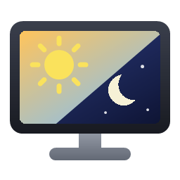

<p align="center"></p>

# BrightnessGlass

A small Windows tray app to control the brightness of your **laptop panel and external monitors** from one glassy, macOS-style panel – with automatic dimming at dusk.

*[Deutsche Beschreibung weiter unten](#deutsch)*

## Features

- **All displays in one place**: laptop panel via WMI, external monitors via DDC/CI (the standard monitor control channel, `dxva2.dll` / VCP code `0x10`). No vendor tools or drivers needed.
- **"All" master slider**: external monitors follow it 1:1, the laptop panel keeps a configurable floor (default 12 %), so at 0 % the room goes dark but the laptop stays readable. At 100 % everything is at full brightness.
- **Follow the sun**: dimming starts a configurable number of minutes before sunset (default 15) and ends at civil dusk; in the morning it runs the other way. The day/night levels are learned when you move "All" while automatic mode is on.
- **Location** is taken from the Windows location service (rounded to ~1 km, no web request) or entered manually. The default before a fix is the centre of Germany.
- **Global hotkeys** (configurable): `Ctrl+Alt+B` opens the panel, `Ctrl+Alt+F10/F11/F12` set all displays to 0/50/100 %.
- **German and English UI**, following the Windows display language.
- Single ~45 KB exe, no installer, no runtime besides .NET Framework 4.x (part of Windows 10/11).

## Install

1. Download `BrightnessGlass.exe` from the [latest release](https://github.com/sasbau/BrightnessGlass/releases/latest).
2. Put it anywhere (e.g. `C:\Tools\BrightnessGlass\`) and run it. A sun icon appears in the tray.
3. Right-click the tray icon → *Start with Windows*.

The exe is not code-signed, so Windows SmartScreen may warn on first start (*More info → Run anyway*). Each release contains a `.sha256` file to verify the download.

## Usage

| Action | How |
| --- | --- |
| Open panel | Left-click tray icon or `Ctrl+Alt+B` |
| Adjust | Drag a slider, mouse wheel over a slider, arrow keys adjust "All" |
| Presets | `Ctrl+Alt+F10` / `F11` / `F12` → 0 / 50 / 100 % |
| Settings | *Settings…* in the panel or tray menu |

Command line (handy for scripts or other hotkey tools):

```
BrightnessGlass.exe list          # displays and current brightness
BrightnessGlass.exe 40            # set "All" to 40 %
BrightnessGlass.exe 40 P34w       # set one display (name filter) directly
BrightnessGlass.exe sun           # today's twilight schedule
BrightnessGlass.exe --version
```

Settings are stored per user in `HKCU\Software\BrightnessDDC`.

## Limitations

- The monitor must support DDC/CI (most do; sometimes it has to be enabled in the monitor's OSD menu). Some docks, adapters (e.g. DisplayLink) and TVs don't pass DDC/CI through – those displays won't show up.
- `Ctrl+Alt+<digit>` is avoided on purpose: on German keyboards that is AltGr and would block characters like `}` or `]`.

## Build

Requires only Windows with .NET Framework 4.x – no Visual Studio or .NET SDK.

```powershell
.\build.ps1                 # -> dist\BrightnessGlass.exe, version derived from git tags
.\build.ps1 -Version 1.2.3  # explicit version
```

The version comes from the latest `vX.Y.Z` tag; commits after a tag build as `X.Y.Z-dev.N+sha`. GitHub Actions builds every push and pull request; pushing a tag `vX.Y.Z` publishes a release with the exe and its checksum.

The icon is generated by `tools\make-icon.ps1`.

---

<a name="deutsch"></a>
## Deutsch

BrightnessGlass ist eine kleine Tray-App für Windows, die die Helligkeit von **Laptop-Display und externen Monitoren** in einem gläsernen Panel im macOS-Stil steuert – inklusive automatischem Dimmen in der Dämmerung.

- **Alle Bildschirme an einem Ort**: Laptop über WMI, externe Monitore über DDC/CI. Keine Hersteller-Software nötig.
- **Regler „Alle“**: Externe Monitore folgen 1:1, der Laptop behält eine einstellbare Untergrenze (Standard 12 %).
- **Nach Sonnenstand**: Dimmen beginnt X Minuten vor Sonnenuntergang (Standard 15) und endet in der bürgerlichen Dämmerung; morgens umgekehrt. Verschiebst du „Alle“ bei aktiver Automatik, merkt sich die App das als neuen Tag- bzw. Nachtwert.
- **Standort** über den Windows-Standortdienst (auf ~1 km gerundet, keine Webanfrage) oder manuell.
- **Hotkeys** (änderbar): `Strg+Alt+B` öffnet das Panel, `Strg+Alt+F10/F11/F12` setzen alle auf 0/50/100 %.
- **Deutsch und Englisch**, je nach Windows-Anzeigesprache.

**Installation:** `BrightnessGlass.exe` aus dem [neuesten Release](https://github.com/sasbau/BrightnessGlass/releases/latest) laden, an einen beliebigen Ort legen und starten. Rechtsklick aufs Tray-Symbol → *Mit Windows starten*. Die Exe ist nicht signiert, SmartScreen warnt beim ersten Start eventuell (*Weitere Informationen → Trotzdem ausführen*).

## License

[MIT](LICENSE)
